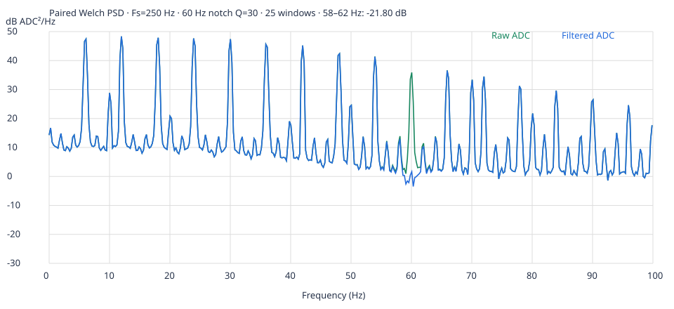

# ECG Monitor

ESP32 + AD8232 的 USB 心電波形介面。資料只在本機瀏覽器處理，沒有 CDN、後端或上傳功能。這次只更新網頁：**硬體腳位、USB 格式與 `firmware/ECGSerial/ECGSerial.ino` 完全不變**，不必重新燒錄。

## 合併與更新網站

1. 開啟本次 PR，確認目標為 `main`，檢查 Files changed 與測試紀錄後按 **Merge pull request → Confirm merge**。若是 Draft PR，先按 **Ready for review**。
2. 若 GitHub Pages 設為從 `main` 發布，合併會觸發原有發布流程。到儲存庫 **Actions** 或 **Settings → Pages** 確認部署完成。本次開發只推送功能分支，未合併或自行發布。
3. 開啟 `https://cyt950413.github.io/ecg-monitor/`（若有自訂 Pages 網址，以 Settings → Pages 顯示為準），按 **Ctrl+Shift+R**（macOS：**Cmd+Shift+R**）強制重新整理。應看見「上下比較」「獨立記錄」「用同一份 CSV 比較」。
4. 若看到舊版，確認 Pages 的來源分支與部署結果，再於 DevTools Network 勾選 Disable cache 重新整理。`index.html` 和新增的 `ecg-core.js` 必須同時部署；不需建置。

本機測試可執行 `python3 -m http.server 8000`，以電腦版 Chrome / Edge 開啟 `http://localhost:8000`。Web Serial 需要 HTTPS 或 localhost；Safari、Firefox 與多數行動瀏覽器不支援，但仍可載入 CSV 或示範。

## 即時操作與原接線

保留現有可正常運作的韌體、TFT 與 AD8232 接線。關閉 Arduino Serial Monitor / Plotter 後選 **115200**，按「連接 ESP32」選取序列埠。USB 仍為 8N1 ASCII `timestamp_ms,raw_adc,status\n`（接受 CRLF）：

```text
1234,2048,2
1238,0,0
1242,1980,1
```

狀態為 0 電極脫落、1 等待穩定、2 正常。TFT 接腳 CS/DC/RST＝27/25/26、SCK/MOSI＝18/23；AD8232 OUTPUT＝34、LO+/LO−＝13/14。網站不會對裝置傳送控制資料，也不變更原三秒接觸穩定等待。

## 原始與濾波比較

「波形顯示」可選 **原始波形 / 60 Hz 濾波波形 / 上下比較**。上下圖共用同一時間範圍與固定 ADC 尺度 −512–4607，包含一定的濾波超越量；超出顯示範圍僅裁切畫面，不裁切數值。未換算 mV。無效接觸樣本保留於緩衝與匯出，但不連成有效心電波形。

- 原始 `adc`、裝置時間與狀態永遠保留，不以濾波值覆寫，不插值、不補造缺失樣本。重複時間的有效 CSV 樣本也保留，並觸發濾波重設。循環緩衝僅供畫面；需要保存全部資料時，請使用獨立記錄。
- 二階因果 IIR notch：**Fs＝250 Hz、f0＝60 Hz、Q＝30**，Q 定義為中心頻率 / −3 dB 頻寬（2 Hz），與 `scipy.signal.iirnotch(60,30,fs=250)` 相同，版本 `iirnotch-v1`。
- 每筆資料進入時才更新一次濾波器。`requestAnimationFrame` 只讀取計算結果；切換波形、視窗長度、暫停及畫面幀率不影響濾波結果。
- 啟動、資料來源切換、裝置重啟、相鄰時間不等於 4 ms（含重複時間）、接觸狀態非 2、序列中斷或超過 2 秒未收到資料時重設。32-bit `millis()` 正常溢位按連續時間處理，不誤認為重啟。4 ms 為此版本固定 Fs 的嚴格連續條件，不代表所有裝置時間抖動皆為遺失樣本。
- 每次恢復後前 **250 筆有效且連續樣本**標示暖機（約 1 秒），濾波圖以黃色顯示。以第一筆 ADC 的常數輸入狀態初始化，減少零初始狀態造成的虛假 DC 跳變；不是基線修正。暖機長度是此初版工程選擇，不是量測品質保證。
- 此濾波會有**頻率相關的相位/群延遲**，不是固定幾毫秒，也不是零相位。不移動時間軸來假裝對齊，不加強力平滑、基線修正或 BPM。
- ADC＝0 或 4095 原值保留並標示可能飽和；正常與無效狀態端點值分開計數。原始圖紅點標出正常狀態的端點值。**濾波無法修復截頂，也無法證明訊號來自有效心電活動。**

差分方程為 `y[n]=b0*x[n]+b1*x[n−1]+b2*x[n−2]−a1*y[n−1]−a2*y[n−2]`，係數：

```text
b = [0.975478390750534, -0.12250158988968947, 0.975478390750534]
a = [1, -0.12250158988968947, 0.9509567815010681]
w0 = 2*pi*60/250; beta = tan(w0/(2*30)); gain = 1/(1+beta)
```

## 暫停顯示與獨立記錄

| 操作         | 效果                                                                     |
| ------------ | ------------------------------------------------------------------------ |
| 暫停顯示     | 凍結目前畫面；接收、濾波與記錄持續                                       |
| 清除即時畫面 | 只清空即時緩衝與凍結畫面；不重設裝置時間、濾波或已存紀錄；CSV 檢視時停用 |
| 匯出即時緩衝 | 匯出最近 60 秒、最多 15,000 筆；不是完整長時間紀錄                       |
| 開始記錄     | 從按下後的下一筆資料開始，另存獨立陣列，不共享即時循環緩衝的淘汰操作     |
| 停止記錄     | 固定已存資料；後續接收、清除畫面、切換來源或匯入檔案不會覆蓋             |
| 匯出紀錄     | 匯出停止後保存的整段資料，檔名含 `recording` 與來源                      |
| 刪除已存紀錄 | 要求明確確認後才刪除；請先匯出，才能開始下一段                           |

記錄上限為 **5 分鐘或 75,000 筆**，以先達者自動停止並顯示原因，不淘汰舊紀錄。同時檢查瀏覽器經過時間及資料時間；沒有新樣本也會停止。背景分頁計時器被瀏覽器延後時，提示可能延後更新，但下一筆資料加入前會先檢查限制。序列連線或示範停止也自動停止記錄。USB 與示範不混寫於同一紀錄。已存紀錄存在時不能開始另一段；停止後不會自行消失。

記錄保存在**記憶體**，不是永久儲存。頁面會在有紀錄時提示離開，但仍須在關閉或重新整理前主動下載 CSV。

## CSV 格式與同檔比較

新版 CSV 保留前五欄，新增獨立欄位，不改 USB 裝置格式：

```text
time_ms,device_ms,adc,status,source,filtered_adc,filter_warmup,saturated,filter_reset,segment,filter_fs_hz,filter_center_hz,filter_q,filter_version
```

`time_ms` 為網頁正規化時間（裝置重啟後接續顯示）；`device_ms` 為未改動的裝置時間。`source`＝`usb` / `demo`。無效接觸時 `filtered_adc` 留空；浮點濾波值不四捨五入或限制於 0–4095。暖機、可能飽和旗標為 0/1；`filter_reset` 與 `segment` 記載重設邊界，每行另附 Fs、中心頻率、Q 與版本。

用同一份資料比較：

1. 保存舊版實測 CSV；不必重新量測來比較不同時間的人體訊號。
2. 更新網站後先停止 USB / 示範，在「用同一份 CSV 比較」選原檔。
3. 原始 `time_ms`、`device_ms`、`adc`、`status` 與來源完整保留。最多載入 75,000 筆、20 MiB；超限、混合來源或格式錯誤時整份拒絕，保留原畫面，不偷偷截斷。
4. 切換三種顯示，使用相同的時間窗與檢視終點滑桿，觀察同一段的原始值、濾波值、暖機與飽和提示。滑桿使用 CSV 原本的 `time_ms` 秒數。
5. 舊版五欄與新版 CSV 都可讀取；一律依原始 ADC 重算，不採用 CSV 既有濾波值。新版的重設註記也用於重建中斷邊界。匯入後前一秒會重新暖機；若原紀錄從持續運作的濾波器中途開始，起始輸出可能與原先即時計算不同。這是初始化差異，不改動原始 ADC。
6. 匯入資料與已停止的獨立記錄分開。匯入不是開始新量測，不會寫入紀錄；原始檔仍由你自行保存。

如需定量比較，在本機執行：

```sh
node tests/analyze-csv.cjs path/to/your.csv /tmp/ecg-analysis
```

輸出 `csv-analysis.json` 與 `csv-spectrum.svg`。使用共同的正常/過暖機/連續 4 ms 區段，以 1024 點 Hann、50% 重疊 Welch PSD 比較；不跨缺口或插值。此分析只排除不適合估計穩態頻譜的區段，**不刪除原檔任何資料**。若沒有足夠長的有效區段，明確回報無法估計。

## 這次附件的結果與測試

實際附件與需求文字的統計不一致：讀到 **14,873 筆、59.997 秒、平均 247.879 Hz**，正常狀態有 **271 筆 ADC＝0、0 筆 ADC＝4095**，有 **31 個 19–22 ms 間隔**。測試以實際檔案為準，SHA-256 見 [測試紀錄](TEST_RESULTS.md)。

相同樣本的 58–62 Hz 頻帶功率由 **1618.6024 降為 10.6926 ADC²（−21.80 dB）**；5–40 Hz 功率由 **138416.0532 降為 138365.8695 ADC²**。原始主峰位於 60.0586 Hz 頻率格點。這是這份資料、這些穩態區段的結果，不代表所有 60 Hz 干擾都會消失，也不代表飽和、接觸或雜訊問題已解決。未將原始 CSV 加入儲存庫。



執行測試（網站本身沒有 npm 相依套件）：

```sh
node tests/core.cjs
# 瀏覽器測試需 Playwright 與 Chromium
npm install --no-save --package-lock=false playwright@1.62.1
node tests/browser.cjs
node tests/notch-browser.cjs
# 可選：附上自己的檔案，同時測試實測 CSV 匯入
node tests/notch-browser.cjs path/to/ecg-usb-2026-10-29T15-16-50-546Z.csv
# Chromium 不在 /usr/bin/chromium 時，設定 CHROMIUM_PATH
# 可選獨立科學計算參考驗證，需要 NumPy / SciPy
python3 tests/scipy-reference.py
```

核心測試涵蓋已知 10+60 Hz 訊號的選擇性抑制、DC 保留、暖機與重設、停止後不覆蓋、雙上限、來源隔離與 CSV。瀏覽器測試使用模擬 Web Serial，不連實體裝置。[完整紀錄](TEST_RESULTS.md)列出結果及限制。

本網站不是醫療診斷工具，濾波後外觀改善不構成量測品質認證。保留原有人體量測電氣隔離要求；未隔離時請先移除人體電極，以訊號模擬器測試。
